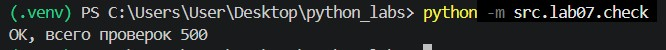

# ЛР7 — Поиск, сортировка и измерение времени
## Задание A: Поиск
- Модуль `src/lab07/search.py`
- Функции `linear_search`, `binary_search`, `two_sum_brute`, `two_sum_fast`
___
### linear_search
Проходит список и сравнивает элемент с числом, которое нужно найти.

Возвращает индекс первого вхождения или -1 (если элемента нет).

**Сложность: О(n)** (один раз проходит список).
```python
def linear_search(nums, x):
    """Индекс первого вхождения x или -1.
 
    linear_search([4, 2, 7, 2], 2) -> 1
    linear_search([4, 2, 7, 2], 9) -> -1
    linear_search([], 1) -> -1
    """
    for i in range(len(nums)):
        if x==nums[i]:
            return i
    return -1
```
___
### binary_search
Ищет число в отсортированном списке, задает верхнюю и нижнюю границы, сравнивая середину текущей области с искомым числом, затем уменьшает область, пока середина не совпадет с числом, которое ищем. 

Возвращает индекс числа или -1 (если элемента нет).

**Сложность: О(log n)**  (на каждом шаге цикла область поиска уменьшается примерно вдвое).
```python
def binary_search(sorted_nums, x):
    """Индекс x в отсортированном по возрастанию списке или -1.
    На неотсортированном списке результат не определён.
 
    binary_search([1, 3, 5, 7], 5) -> 2
    binary_search([1, 3, 5, 7], 4) -> -1
    binary_search([5], 5) -> 0
    binary_search([], 5) -> -1
    """
    lo=0
    hi=len(sorted_nums)-1
    while lo <= hi:
        mid=(lo+hi)//2
    
        if sorted_nums[mid]==x:
            return mid
        elif sorted_nums[mid]<x:
            lo=mid+1
        elif sorted_nums[mid]>x:
            hi=mid-1
    return -1
```
___
### two_sum_brute
Для каждого элемента списка ищет среди оставшихся такой элемент, который в сумме будет давать target.

Возвращает кортеж из пары индексов или None (если подходящих элементов нет).

**Сложность: О(n^2)** (цикл в цикле).
```python
def two_sum_brute(nums, target):
    """Пара индексов (i, j), i < j, nums[i] + nums[j] == target, или None.
 
    two_sum_brute([2, 7, 11, 15], 9) -> (0, 1)
    two_sum_brute([1, 2], 10) -> None
    """
    for i in range(len(nums)-1):
        for j in range(i+1,len(nums)):
            if nums[i]+nums[j]==target:
                return (i,j)
    return None
```
___
### two_sum_fast
Для каждого элемента списка ищет, сколько не хватает до target, и проверят, есть ли такое число в уже просмотренной части списка (словарь seen, в котором хранится число и его индекс).

Возвращает кортеж из пары индексов или None (если подходящих элементов нет).

**Сложность: О(n)** (один проход цикла).
```python
def two_sum_fast(nums, target):
    """То же, что two_sum_brute, но за один проход со словарём."""
    seen={}
    for i in range(len(nums)):
        need=target-nums[i]
        if need in seen:
            return (seen[need],i)
        seen[nums[i]]=i
    return None
```
___

## Задание B: Сортировки
- Модуль `src/lab07/sorting.py`
- Функции `bubble_sort`, `insertion_sort`, `selection_sort`
___
### bubble_sort
Сортировка "пузырьком": проходит по списку необходимое количество раз, меняя соседние элементы, если они стоят в неправильном порядке, пока весь список не будет стоять в порядке возрастания.

Возвращает новый отсортированный список.

**Сложность: О(n^2)** (цикл в цикле) или **О(n)** (если список сразу отсортирован).
```python
def bubble_sort(nums):
    """Новый список, отсортированный по возрастанию. Исходный не меняется.
 
    bubble_sort([3, 1, 2]) -> [1, 2, 3]
    bubble_sort([2, 2, 1]) -> [1, 2, 2]
    bubble_sort([]) -> []
    """
    nums=list(nums)
    for i in range(len(nums)):
        swapped = False
        for j in range(len(nums)-1-i):
            if nums[j] > nums[j+1]:
                nums[j], nums[j+1] = nums[j+1], nums[j]
                swapped = True
        if not swapped:
            break
    return nums
```
___
### insertion_sort
Сортировка вставками: сдвигает элементы, которые больше текущего вправо, и вставляет в подходящее место.

Возвращает новый отсортированный список.

**Сложность: О(n^2)** (while в цикле) или **О(n)** (если список сразу отсортирован).
```python
def insertion_sort(nums):
    nums=list(nums)
    for i in range(1, len(nums)):
        current=nums[i]
        j=i-1
        while j>=0 and nums[j]>current:
            nums[j+1]=nums[j]
            j-=1
        nums[j+1]=current
    return nums
```
___
### selection_sort
Сортировка выбором: ищет минимальное число хвоста и вставляет его на границу отсортированной части.

Возвращает новый отсортированный список.

**Сложность: О(n^2)** (внутренний цикл всегда проходит весь остаток, независимо от данных).
```python
def selection_sort(nums):
    nums=list(nums)
    for i in range(len(nums)-1):
        min_ind=i
        for j in range(i+1,len(nums)):
            if nums[j]<nums[min_ind]:
                min_ind=j
        if min_ind!=i:
            nums[i],nums[min_ind]=nums[min_ind],nums[i]
    return nums
```
___

## Задание C: Проверка против эталона
- Модуль `src/lab07/check.py`
- Функции `check_sorting`, `check_search`, `check_two_sum`
- Необходимые импорты:
```python
import random
from src.lab07.sorting import bubble_sort, insertion_sort, selection_sort
from src.lab07.search import linear_search, binary_search, two_sum_brute, two_sum_fast
```
___
### check_sorting
Проверяет функцию сортировки на случайных списках: результат должен совпадать с sorted(), а исходный список - не меняться. При несовпадении поднимается AssertionError с указанием проблемного входа.

```python
def check_sorting(fn, trials=100):
    """сравнивает fn(nums) со sorted(nums)"""
    for _ in range(trials):
        n = random.randint(0, 50)
        nums = [random.randint(-100, 100) for _ in range(n)]
        original = list(nums)
        result = fn(nums)
        assert result == sorted(nums), f"{fn.__name__} ошиблась на {nums}: {result}"
        assert nums == original, f"{fn.__name__} изменила исходный список"
    return trials
```
___
### check_search
Проверяет функции поиска на случайных списках: результат `linear_search` должен совпадать с nums.index(), а для `binary_search` элемент по индексу должен совпадать с x (могут быть повторы, поэтому важно просто наличие элемента). При несовпадении поднимается AssertionError с указанием проблемного входа.

```python
def check_search(trials=100):
    """сравнивает linear_search и binary_search с list.index"""
    for _ in range(trials):
        n = random.randint(0, 50)
        nums = [random.randint(-100, 100) for _ in range(n)]
        x = random.randint(-150, 150)
        sorted_nums = sorted(nums)

        try:
            expected = nums.index(x)
        except ValueError:
            expected = -1
        assert linear_search(nums, x) == expected, f"linear_search ошиблась на {nums}, x = {x}"
        
        result_binary = binary_search(sorted_nums, x)
        if result_binary != -1:
            assert  0 <= result_binary < len(sorted_nums), f"индекс вне диапазона {len(sorted_nums)}: функция выдала {result_binary}"
            assert sorted_nums[result_binary] == x, f"binary_search ошиблась на {nums}, x = {x}"
        else:
            assert x not in sorted_nums, f"binary_search не нашла {x} в {sorted_nums}"
    return trials
```
___
### check_two_sum
Проверяет функции поиска пары чисел на случайных списках: результат должен совпадать с эталоном. При несовпадении поднимается AssertionError с указанием проблемного входа.

```python
def check_two_sum(trials=100):
    """ оба способа должны давать пару с нужной суммой или оба None
    
    при расхождении — AssertionError с данными, на которых разошлось"""
    for _ in range(trials):
        n = random.randint(0, 50)
        nums = [random.randint(-50, 50) for _ in range(n)]
        x = random.randint(-200, 200)

        res_brute = two_sum_brute(nums, x)
        res_fast  = two_sum_fast(nums, x)
        expected = []
        for i in range(len(nums)):
            for j in range(i + 1, len(nums)):
                if (nums[i] + nums[j]) == x:
                    expected.append((i, j))
        if expected:
            assert res_brute in expected, f"two_sum_brute ошибся на {nums}, target = {x}"    
            assert res_fast in expected, f"two_sum_fast ошибся на {nums}, target = {x}"    
        
        else:            
            assert res_brute is None, f"two_sum_brute нашел результат, хотя ожидалось None"
            assert res_fast is None, f"two_sum_fast нашел результат, хотя ожидалось None"
    return trials
```
___
### Запуск проверок
Прогоняет все проверки и печатает их суммарное число.
```python
if __name__ == "__main__":
    random.seed(42)
    total_check = 0
    for fn in (bubble_sort, insertion_sort, selection_sort):
        total_check += check_sorting(fn)
    total_check += check_search()
    total_check += check_two_sum()
    print(f"OK, всего проверок {total_check}")
```
Запуск: `python -m src.lab07.check `
Вывод в терминал: 



## Задание D: Бенчмарк
- Модуль `src/lab07/bench.py`
- Функции `bench_sorts`, `bench_search`, `bench_2sum`
- Необходимые импорты:
```python
import timeit
import random
from src.lab04.io_txt_csv import write_csv
from src.lab07.sorting import bubble_sort, insertion_sort, selection_sort
from src.lab07.search import linear_search, binary_search, two_sum_brute, two_sum_fast

```
___
### bench_sorts
Замеряет время sorted() и трёх написанных сортировок на списках размером 1_000, 10_000 и 100_000 элементов и возвращает результаты списком кортежей. Для 100_000 написанные сортировки не запускает (слишком долго) — пишет ">60".
```python
def bench_sorts():
    random.seed(42)
    rows = []
    for n in (1_000, 10_000, 100_000):
        data = [random.randint(-10**6, 10**6) for _ in range(n)]
        t = timeit.timeit(lambda: sorted(data), number=1)
        rows.append(("sort", n, "sorted", f"{t:.6f}"))

        for func in (bubble_sort, insertion_sort, selection_sort):
            name = func.__name__
            if n <= 10_000:
                time = timeit.timeit(lambda: func(data), number = 1)
                rows.append(("sorting", n, name, f"{t:.6f}"))
            else:
                rows.append(("sorting", n, name, ">60"))
    return rows
```
___
### bench_search
Замеряет время функций на 10 000 запросах. Возвращает список кортежей.
```python
def bench_search():
    random.seed(42)
    rows = []
    data = [random.randint(-10**6, 10**6) for _ in range(100_000)]
    targets = [random.choice(data) for _ in range(10000)]
        
    t_lin = timeit.timeit(lambda: [linear_search(data, x) for x in targets], number=1)
    rows.append(("search", 100_000, "linear_search", f"{t_lin:.6f}"))
        
    sorted_data = sorted(data)
    t_bin = timeit.timeit(lambda: [binary_search(sorted_data, x) for x in targets], number=1)
    rows.append(("search", 100_000, "binary_search", f"{t_bin:.6f}"))
    return rows
```
___
### bench_2sum
Замеряет время функций на 1_000 и 10_000 запросах. Функции получают одни и те же данные. Возвращает список кортежей.
```python
def bench_2sum():
    random.seed(42)
    rows = []
    
    for n in (1_000, 10_000):
        data = [random.randint(-10**6, 10**6) for _ in range(n)]
        a, b = random.sample(data, 2)
        target = a + b

        t_2sb = timeit.timeit(lambda: two_sum_brute(data, target), number=1)
        rows.append(("two_sum", n, "two_sum_brute", f"{t_2sb:.6f}"))

        t_2sf = timeit.timeit(lambda: two_sum_fast(data, target), number=1)
        rows.append(("two_sum", n, "two_sum_fast", f"{t_2sf:.6f}"))
    
    return rows
```
___
### main
Собирает результаты всех трёх бенчмарков, сохраняет их в CSV и печатает выровненную таблицу в консоль.
```python
def main():
    rows = bench_sorts() + bench_search() + bench_2sum()
    write_csv(rows, "data/lab07/bench.csv", ("задание", "n", "функция", "секунды"))

    max_len = 0
    for func in (bubble_sort, insertion_sort, selection_sort, linear_search, binary_search, two_sum_brute, two_sum_fast):
        name = func.__name__
        max_len = max(max_len, len(name))
    
    print(f"{'задание':<12} | {'n':<8} | {'функция':<{max_len}} | {'секунды':<12}")
    print("-" * (41 + max_len))
    for task, n, func, sec in rows:
        print(f"{task:<12} | {n:<8} | {func:<{max_len}} | {sec:<12}")
```
___
Запуск: `python -m src.lab07.bench`