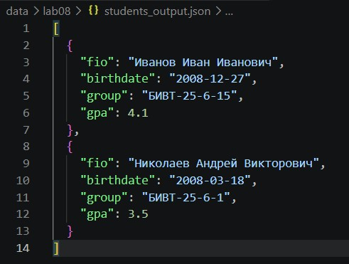
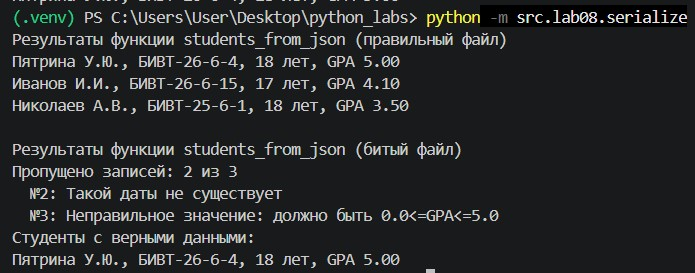

# ЛР8 – Модель данных без классов: запись Student как словарь, валидация и сериализация
##  Задание A: Реализовать модель Student (models.py)
Импорты и константы
```python
from datetime import date
import re

STUDENT_FIELDS = ("fio", "birthdate", "group", "gpa")
GROUP = re.compile(r"[А-ЯЁ]+(?:-\d+){3}")
DATE = re.compile(r"\d{4}-\d{2}-\d{2}")
```
### validate_student
Валидация входных данных:
- на входе словарь с ключами из `STUDENT_FIELDS` 
- ФИО - непустая строка, нет лишних или недостающих данных (фамилия, имя (+ отчество при наличии))
- дата рождения - непустая строка формата `YYYY-MM-DD`, дата существует, не из будущего
- группа - непустая строка, соответствует маске `GROUP` (регулярное выражение)
- GPA - int или float, находится в диапазоне 0.0<=GPA<=5.0

```python
def validate_student(rec) -> None:
    """Валидация данных студента"""
    if not isinstance(rec, dict):
        raise TypeError("На входе должен быть словарь")
    if set(rec.keys()) != set(STUDENT_FIELDS):
        raise ValueError("Неверно введены данные")
    fio, birthdate, group, gpa = (rec[key] for key in STUDENT_FIELDS)
    
    if not isinstance(fio, str):
        raise TypeError("Неверный тип ФИО")
    fio = fio.strip()
    if len(fio) == 0:
        raise ValueError("Пустое имя")
    if len(fio.split()) > 3:
        raise ValueError("Лишние данные в ФИО")
    if len(fio.split()) < 2:
        raise ValueError("Недостаточно данных в ФИО, должны быть фамилия, имя (+ отчество при наличии)")
    
    if not isinstance(birthdate, str):
        raise TypeError("Неверный тип даты рождения, должна быть строка")
    birthdate = birthdate.strip()
    if len(birthdate) == 0:
        raise ValueError("Пустая дата рождения")
    if not DATE.fullmatch(birthdate):
        raise ValueError("Неверный формат даты рождения, должно быть YYYY-MM-DD")
    try:
        b = date.fromisoformat(birthdate)
    except ValueError:
        raise ValueError("Такой даты не существует")
    if b > date.today():
        raise ValueError('Дата рождения из будущего')
   
    if not isinstance(group, str):
        raise TypeError("Неверный тип группы")  
    group = group.strip()  
    if len(group)==0:
        raise ValueError("Пустая группа")
    if not GROUP.fullmatch(group):
        raise ValueError("Неверная запись группы, должен быть например БИВТ-26-6-4")

    if isinstance(gpa, bool) or not isinstance(gpa, (int, float)):
        raise TypeError(f"Неверный тип GPA")
    gpa = float(gpa)
    if not (0.0 <= gpa <= 5.0):
        raise ValueError("Неправильное значение: должно быть 0.0<=GPA<=5.0")
```
### make_student
Создание словаря с данными студента

ФИО, дата рождения и группа без лишних пробелов, GPA - float
```python
def make_student(fio, birthdate, group, gpa) -> dict:
    """Создание словаря с данными студента"""
    rec = {
        "fio": fio,
        "birthdate": birthdate,
        "group": group,
        "gpa": gpa}
    validate_student(rec)

    rec["fio"] = fio.strip()
    rec["birthdate"] = birthdate.strip()
    rec["group"] = group.strip()
    rec["gpa"] = float(gpa)
    return (rec)
```

### student_age
Вычисляет, сколько полных лет на дату `today` (передается при вызове функции или устанавливается при помощи модуля `datetime`)
```python
def student_age(rec, today=None) -> int:
    """Полных лет на дату today"""
    b = date.fromisoformat(rec["birthdate"])
    today = today or date.today()
    if (today.month, today.day) >= (b.month, b.day):
        return today.year - b.year
    else:
        return today.year - b.year - 1
```

### student_to_dict
Создает копию записи для сериализации с валидированными данными
```python
def student_to_dict(rec):
    """Копия записи для сериализации, данные валидированы"""
    validate_student(rec)
    return {
        "fio": rec["fio"],
        "birthdate": rec["birthdate"],
        "group": rec["group"],
        "gpa": rec["gpa"]
    }
```

### student_from_dict
Десериализация из словаря с валидацией
```python
def student_from_dict(d):
    """Десериализация из словаря с валидацией"""    
    fio, birthdate, group, gpa = (d[key] for key in STUDENT_FIELDS)
    return make_student(fio, birthdate, group, gpa)
```

### format_student
Красивый вывод данных, пример: Иванов И.И. БИВТ-26-6-1, 19 лет, GPA 4.30
```python
def format_student(rec):
    """Красивый вывод: Иванов И.И. БИВТ-26-6-1, 19 лет, GPA 4.30"""
    validate_student(rec)
    age = student_age(rec)

    fio = rec["fio"].split()
    surname = fio[0].capitalize()
    initials = ".".join(word[0].upper() for word in fio[1:]) + "."
    fio_new = f"{surname} {initials}"

    return f"{fio_new}, {rec['group']}, {age} лет, GPA {rec['gpa']:.2f}"
```

## Задание B: Реализовать модуль serialize.py
Импорты
```python
import json
from pathlib import Path
from src.lib.io_helpers import ensure_parent_dir
from src.lab08.models import (
    make_student, 
    format_student,
    student_to_dict,
    student_from_dict
)
```

### students_to_json
Сохраняет список записей в JSON
```python
def students_to_json(students, path):
    """Сохраняет список записей в JSON"""
    data = [student_to_dict(s) for s in students]

    json_file = Path(path)
    ensure_parent_dir(json_file)

    with open(json_file, "w", encoding = "utf-8") as f:
        json.dump(data, f, ensure_ascii=False, indent=2)
```
Исходные данные (в блоке функции `main`):
```python
student1 = make_student("Иванов Иван Иванович", "2008-12-27", "БИВТ-25-6-15", 4.1)
student2 = make_student("Николаев Андрей Викторович", "2008-03-18", "БИВТ-25-6-1", 3.5)
students = [student1, student2]

students_to_json(students, "data/lab08/students_output.json")
```
Результат в `students_output.json`:



### students_from_json
- проверяет, что json файл существует
- открывает, сохраняет данные в `data`, проверяет, что данные есть, являются списком словарей
- отдельно проверяет данные каждого студента: 
    * если словарь битый, записывает в `skipped` номер студента (начиная с 1) и пояснение ошибки
    * если данные верны, выводит в терминал данные (формат функции `format_student`)
- в терминал выводится сколько было пропущено и почему
```python
def students_from_json(path) -> list[dict]:
    json_file = Path(path)

    if not json_file.exists():
        raise FileNotFoundError("файл отсутствует")
    if json_file.suffix.lower() != ".json":
        raise ValueError("неверный тип файла, должен быть .json")

    with open(json_file, "r", encoding="utf-8") as f:
        try:
            data = json.load(f)
        except json.JSONDecodeError:
            raise ValueError("Пустой JSON или неподдерживаемая структура")
        
    if not data:
        raise ValueError("пустой json файл")
    if not isinstance(data,list):
        raise ValueError("неверный тип данных")

    students = []
    skipped = []
    for number, raw in enumerate(data, start = 1):
        if not isinstance(raw, dict):
            skipped.append((number, "не словарь"))
            continue  
        try:        
            students.append(student_from_dict(raw))
        except (ValueError, TypeError) as e:
            skipped.append((number, str(e)))

    if skipped:
        print(f"Пропущено записей: {len(skipped)} из {len(data)}")
        for number, reason in skipped:
            print(f"  №{number}: {reason}")
        
    return students
```
Исходные данные в `students_input`:
```python
[
  {
    "fio": "Пятрина Устина Юрьевна",
    "birthdate": "2008-04-01",
    "group": "БИВТ-26-6-4",
    "gpa": 5
  },
  {
    "fio": "Иванов Иван Иванович",
    "birthdate": "2008-12-27",
    "group": "БИВТ-26-6-15",
    "gpa": 4.1
  },
  {
    "fio": "Николаев Андрей Викторович",
    "birthdate": "2008-03-18",
    "group": "БИВТ-25-6-1",
    "gpa": 3.5
  }
]
```
Исходные данные в `students_bad` (битые данные):
``` python
[
  {
    "fio": "Пятрина Устина Юрьевна",
    "birthdate": "2008-04-01",
    "group": "БИВТ-26-6-4",
    "gpa": 5
  },
  {
    "fio": "Иванов Иван Иванович",
    "birthdate": "2008-15-27",
    "group": "БИВТ-26-6-15",
    "gpa": 4.1
  },
  {
    "fio": "Николаев Андрей Викторович",
    "birthdate": "2008-03-18",
    "group": "БИВТ-25-6-1",
    "gpa": 7
  }
]
```
Вывод в терминале:


